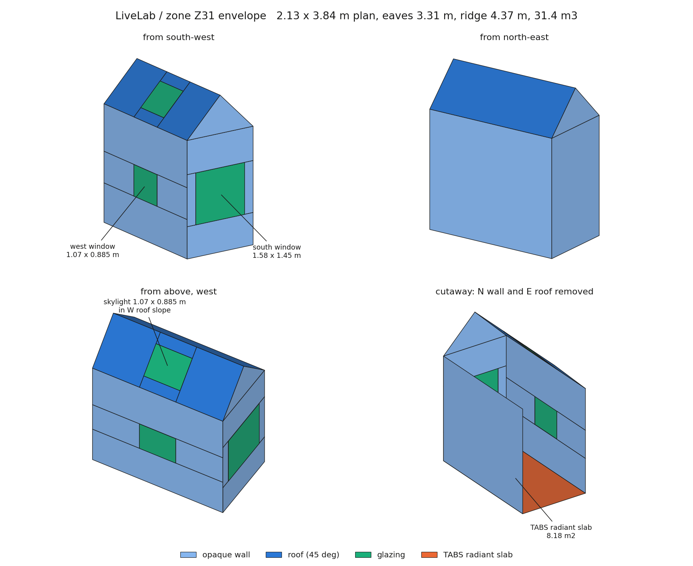
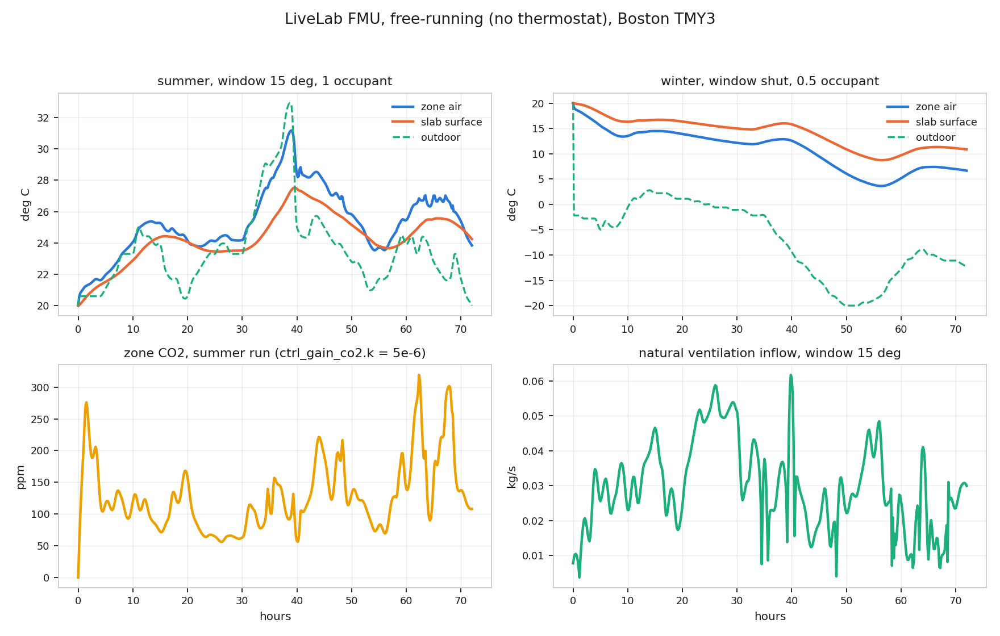
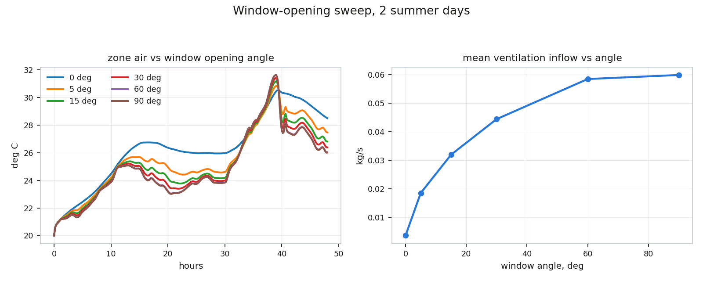

# LiveLab, zone Z31: Modelica model and FMU

`livelab.mo` in this directory is a first-principles
model of the room this dataset calls Z31: an 8.18 m² experimental office
on the third floor of HouseZero, with a pitched roof, a skylight, two
operable windows and a TABS radiant slab. Where `fit.Z31.pt` in this repo
is an LSTM fitted to the measured zone, livelab is the same zone written
as equations — one
[`Buildings.ThermalZones.Detailed.MixedAir`](livelab.mo#L69-L100)
with 73 states, compiled to an FMU and driven from Python. Z31 is the
only zone whose openings (`Z31_S_opening`, `Z31_Sky_opening`) match the
model's south wall plus west-tilted skylight. The Modelica source,
the build scripts and the Boston TMY3 weather file are vendored here;
upstream is the `cselab/livelab` repository.

## Geometry

South-west and north-east exteriors, the skylight in the west roof slope
seen from above, and a cutaway with the north wall and east roof removed
showing the radiant slab.

| | |
|---|---|
| footprint | 2.13 × 3.84 m = 8.18 m² (`AFlo` = 8.17547) |
| volume, mean height | 31.4 m³, 3.838 m (`hRoo` = 3.84) |
| roof | 45° gable, ridge N–S, slopes facing E and W; eaves 3.306 m, ridge 4.371 m |
| south window | 1.58 × 1.45 m |
| west window | 1.07 × 0.885 m |
| skylight | 1.07 × 0.885 m, in the W roof slope |
| surfaces in the drawn solid | slab 8.18, opaque wall 38.50, roof 10.62, glazing 4.18 m² |

The solid is an interpretation, not a fact about the model. A `MixedAir`
zone is lumped: only areas enter the physics, and the model's areas do
not all close into one geometry.
[`datConExt`](livelab.mo#L80)
gives two roof slopes of 2.23 × 4.11 = 9.17 m² each, 18.3 m² in total,
larger than any 45° gable over an 8.18 m² floor can be (10.6 m²). The
drawing reproduces `AFlo`, `hRoo`, the volume and all three window sizes
and orientations exactly, and its south gable wall (8.18 m²) matches
[`datConExtWin[1]`](livelab.mo#L87-L99)
exactly; the roof and side walls are where it departs.

## What is in the model

| part | line |
|---|---|
| weather, Boston TMY3 via `ReaderTMY3` | [L65-L67](livelab.mo#L65-L67), path at [L5](livelab.mo#L5) |
| the zone, `MixedAir` with air, CO2 and humidity | [L69-L100](livelab.mo#L69-L100) |
| 2 exterior roof slopes (E, W) | [L80](livelab.mo#L80) |
| 6 interior partitions | [L81-L86](livelab.mo#L81-L86) |
| 3 glazed constructions: S wall, ceiling skylight, W wall | [L87-L99](livelab.mo#L87-L99) |
| slab interface `surBou` | [L79](livelab.mo#L79) |
| TABS `SingleCircuitSlab`, A = 8.17547 m², 50.3 m of pipe | [L110](livelab.mo#L110) |
| envelope insulation, x = 0.087 m, k = 0.049 W/m/K | [L33](livelab.mo#L33) |

Natural ventilation is single-sided and wind-driven, assembled from two
papers rather than taken from one.
[`var_cp`](livelab.mo#L163-L169)
is the Swami & Chandra 1988 wind pressure coefficient for low-rise
buildings, as a function of wind incidence and building side ratio.
[`var_cd`](livelab.mo#L170-L172)
is the hopper-window discharge coefficient of Wang, Karava & Chen 2015,
clamped by `min(1, ...)`.
[`out_vent_flow`](livelab.mo#L173-L178)
is the mean flow of Wang & Chen 2012, whose height integral
[`f_nv`](livelab.mo#L25-L30)
is evaluated once by `quadratureLobatto` at
[L60](livelab.mo#L60),
with a floor of -0.00366 kg/s standing in for infiltration.

## Inputs, outputs, knobs

| input | default | what it does |
|---|---|---|
| `u_win_angle` | 15 | window opening, 0 to 90°, drives ventilation through `var_cd` |
| `u_occupancy` | 0.5 | occupancy fraction, ~120 W/person of internal gain |

| output | |
|---|---|
| `sn_temp_zone.T` | zone air temperature, K |
| `sn_temp_slab.T` | slab surface temperature, K |
| `sn_co2_zone.ppm` | zone CO2 |
| `sn_rh_zone.phi` | zone relative humidity, 0 to 1 |
| `sn_temp_water_ret.T` | TABS return water, K |
| `sn_temp_vent.T`, `sn_rh_vent.phi` | outdoor air at the vent inlet |
| `out_vent_flow` | ventilation mass flow, kg/s, negative = inflow |

Every `parameter` is reachable at run time through fmpy's
`start_values`. The ones worth touching:
[`mat_insul.x`](livelab.mo#L33)
and `mat_insul.k` (the largest envelope knob),
[`ctrl_temp_water.k`](livelab.mo#L114-L116)
= 295.15 K and `ctrl_mflow_water.k` = 0.02 kg/s (TABS supply),
`ctrl_gain_co2.k` = 0 (CO2 generation is wired but off; ~5e-6 enables
it), `p_cd_rect` = 0.62 and `p_cp_base` = 0.6 (ventilation).

## Building and running

`omc resources/fmu.mos` produces `livelab.fmu`, 3.0 MB, FMI 2.0
co-simulation, built with `--fmiFlags=s:cvode --fmiSources=false`; a few
minutes on macOS arm64 with `omc` 1.27.0-dev. Drive it with fmpy's
`simulate_fmu`.

Buildings must come from the fork
[slitvinov/modelica-buildings](https://github.com/slitvinov/modelica-buildings)
(13.0.0), not the OpenModelica package index. Every index build, 13.0.0
and 13.0.1 alike, defines `LimiterWindDirection` as
`winDir = noEvent(mod(u, uMax))`; `mod` has no time derivative, so
Pantelides index reduction fails with
`IndexReduction.pantelidesIndexReduction failed!`. The fork keeps
`winDir = min(uMax, max(uMin, u))`.

## What it does

Three summer days (window at 15°, one occupant, CO2 generation enabled)
and three winter days (window shut, half an occupant), free-running on
Boston TMY3. Summer zone air tracks outdoor air with the slab lagging
behind; the winter zone drifts from 20 °C to about 4 °C over three days,
which is correct behaviour and not a bug — nothing is there to stop it.

The same two summer days with the window swept from shut to fully open.

| window angle | peak zone air °C | mean inflow kg/s |
|---|---|---|
| 0° | 30.54 | 0.00366 |
| 5° | 30.85 | 0.01855 |
| 15° | 31.18 | 0.03196 |
| 30° | 31.42 | 0.04441 |
| 60° | 31.62 | 0.05845 |
| 90° | 31.64 | 0.05986 |

Inflow saturates past about 60° because `var_cd` is clamped at 1; at 0°
what is left is the infiltration floor `p_vent_floor`. Opening the window
*raises* the peak temperature: on these days outdoor air is hotter than
the zone at the peak. Away from the peak, more opening does cool the
zone, by up to 3 °C.

The figures on this page are drawn by `cad.py` (the envelope, from the
dimensions in `livelab.mo`) and `sim_figs.py` (both runs, through fmpy).

## What it leaves out

No HVAC controller. TABS flow and supply temperature are constants and
nothing tracks a setpoint, so the zone goes wherever physics takes it;
the real Z31 sits near 22 °C because of a controller the model does not
have. No lighting or equipment loads beyond occupancy gain. No interior
shade dynamics (`ctrl_shade` is hardcoded to 1). CO2 generation off by
default.

## References

1. Han, X., Salimi, S., Malkawi, A., Wang, X., & Li, N. (2023,
   September). A validated high-fidelity simulator for an
   ultra-efficient office building based on coupled EnergyPlus-Modelica
   models. In Building Simulation 2023 (Vol. 18, pp. 1256-1263). IBPSA.
2. Wang, H., & Chen, Q. (2012). A new empirical model for predicting
   single-sided, wind-driven natural ventilation in buildings. Energy
   and Buildings, 54, 386-394.
3. Wang, H., Karava, P., & Chen, Q. (2015). Development of simple
   semiempirical models for calculating airflow through hopper, awning,
   and casement windows for single-sided natural ventilation. Energy
   and Buildings, 96, 373-384.
